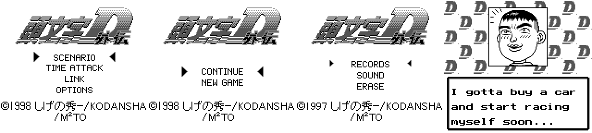

# Initial D Gaiden (GB) — English translation

An English fan translation of *Initial D Gaiden* (頭文字D外伝), the 1998
Game Boy racing game from Kodansha / M²TO. Everything is translated: the story
dialog, menus and menu graphics, prompts, name entry, results screens and
course select. The only Japanese left is the copyright line.

 

## Playing it

This repo does **not** include the game. You need your own copy of the
original Japanese ROM:

| | |
|---|---|
| File | `Initial D Gaiden (Japan) (SGB Enhanced).gb` |
| Size | 262,144 bytes (256 KB) |
| SHA-1 | `1b3c4c1c4dfca46a009eb2e5cd45b343d7ee6681` |

Download the `.ips` patch from the
[latest release](https://github.com/ChrisSewell/initiald-gaiden-en/releases/latest)
and apply it with any IPS patcher, such as
[Rom Patcher JS](https://www.marcrobledo.com/RomPatcher.js/) or Flips. The patched ROM is 512 KB. It plays on DMG/Super Game Boy emulators
and flash carts that support MBC1.

## Building from source

Needs Python 3.10 or later; the build uses only the standard library.

```bash
python3 -I tools/merge_english.py .
python3 -I tools/build_patch.py "Initial D Gaiden (Japan) (SGB Enhanced).gb" . build/initiald-gaiden-en.gb
```

That writes `build/initiald-gaiden-en.gb` (git-ignored) and the `.ips` beside
it. To change the translation, edit the files in `script/`, `font/` or
`graphics/`, then run both commands again. `merge_english.py` checks every
line against the game's size limits before anything is built.

| File | What it holds |
|---|---|
| `script/en_dialog.txt` | Story dialog: `\|` = new line, `//` = new box, 18 chars × 3 lines |
| `script/en_strings.txt` | Names, results screen, credits, name-entry grid |
| `script/en_windows.txt` | Menu window tilemaps (prompts, name entry) |
| `graphics/menus.json` | Redrawn menu and course-name graphics |
| `font/lowercase.txt`, `font/menu5x7.txt` | The added fonts, as ASCII art |
| `script/script.tsv` | Master table: every string's ROM location, original bytes, Japanese and English |

`tools/dump_script.py <rom> script` regenerates `script.tsv` and `script.txt`
from the original ROM.

## Legal

*Initial D* and *Initial D Gaiden* are © Shuichi Shigeno / Kodansha / M²TO.
This is an unofficial fan project, not affiliated with or endorsed by the
rights holders. No ROM is distributed here. The tools, the English text and the
patch are released under the MIT License (see [LICENSE](LICENSE)).

---

# Technical notes

## Source ROM

`Initial D Gaiden (Japan) (SGB Enhanced).gb`: MBC1+RAM+battery, 16 banks.

## Text encoding

Single byte, JIS X 0201 order:

| bytes | meaning |
|---|---|
| `20–5F` | ASCII (space, digits, A–Z, punctuation). No lowercase in the font. |
| `A1–DF` | half-width katakana codes, drawn as **hiragana** |
| `DE` / `DF` | dakuten / handakuten, a separate byte after the kana |
| `62` | `<open>` start of dialog message |
| `63` | `<clear>` clear box, keep going |
| `65` | `<end>` end of string |
| `6C` | `<br>` newline |
| `74` | `<wait>` wait for A |

The dialog box is 18 tiles wide and 3 lines tall. Each text line has a
row above it for dakuten, which is free space for English.

## Where the text is

- **Dialog script**, bank 2 file `0x97C0–0xBE24` (~9.6 KB). 224-entry
  little-endian pointer table at `0x9600` (CPU `$5600`, bank 2). 206 unique
  messages (18 entries share). One message at `0xBB7C` sits inside another
  message's bytes. Eight messages (`O000–O007`) have no table entry and are
  presumably pointed to from code.
- **Inline strings**, bank 1: `ld b,X / ld c,Y / call $0CE0` then the string
  inline, ended by `65`. Results screen ("GET THE NEW CAR"), course names.
- **Tables**, bank 1: rival names (`0x52FA`, 8 bytes each), time-attack
  records (`0x58F8`, 16 bytes each), BGM names, staff credits (`0x5E1C`).
- **Name-entry grid** at `0x5CFA`.
- **Font** at `0x14000` (2bpp, ASCII/JIS X 0201 order).
- **Not text:** kanji menus (続きから, 最初から, 通信, 記録消去, レコード,
  サウンド, どの車にしようかな?) are tile graphics and need graphic edits.

## Files

- `tools/dump_script.py <rom> <out_dir>`: writes `script/script.tsv` (id,
  offsets, raw hex, Japanese, empty English column) and `script/script.txt`.

## Translation

- `script/en_dialog.txt` is the source for the English dialog: `|` starts a new
  line, `//` a new box. Edit there, not in the TSV.
- `tools/merge_english.py <project_dir>` builds the tagged English into the
  `english` column of `script.tsv` and enforces **18 characters per line and
  3 lines per box**, the limits of the 8x8 font. It exits non-zero if a line
  breaks them.
- The English uses lowercase, which the font doesn't have. The kana tiles
  (`0xA1–0xDF`) are free once the game is in English, so lowercase goes there.
- S207 and S208 share bytes in the ROM: S208 starts partway through S207, so
  S207's English must end with S208's.
- The English dialog is ~13.7 KB, against 9.9 KB of Japanese, so it won't fit
  in place.
- `script/en_strings.txt` holds the non-dialog strings: results screen,
  scenario and course names, rival names, time-attack records, credits and the
  name-entry grid. Each keeps its original byte size (`^` centers it in the
  field). Table records and the grid must fit. Nine inline names (the four
  scenario names, plus every course name except Myogi) are longer than the
  Japanese and need relocating by a code patch; the merge tool lists them.
- Keep the kana punctuation tiles 0xA1–0xA5 (。「」、・) when adding lowercase.
  The results screen and the title string still use 「」.
- Open questions: which real course "だるみ" (Darumi) is, and whether the
  centered results-screen strings line up on screen.

## Building

```
python3 -I tools/merge_english.py .
python3 -I tools/build_patch.py "<original.gb>" . build/initiald-gaiden-en.gb
```

`build_patch.py` writes the 512 KB ROM and an IPS beside it:

- **Font:** lowercase a–z goes over kana tiles `B1–CA` and a comma over `CB`
  in the dialog font at `0x14000`. The original font has no comma, slash or
  double quote. Codes `2C 61 5E 2F` draw graphic fragments, not punctuation.
  `2D` is the dash used as a hyphen.
- **Dialog routine:** `$0CE6` (bank 0) indexes the pointer table and switches
  banks via `LD A,$02` at `0x0CF2`, then prints through `$0D05`, also bank 0.
  The script now lives in bank `$10`: table at `$4000`, text after it (ends
  around `$7685`).
- **Inline strings** that grew are moved to `$7F00` in bank 1. Each
  `call $0CE0 + string` site becomes `ld hl,addr / call $0D05 / nop`.
- **Printer facts:** char → tile goes through the 128-entry table at `$0DCB`
  (tile = position in the table). `62` toggles the typewriter effect, `77`
  toggles the window layer, and `DE`/`DF` draw in the row above.
- **Unreferenced messages:** O000–O007 aren't pointed to by anything, so
  they stay in bank 2 untouched.

Tested in PyBoy: the opening scene and the Iketani scene show English with
lowercase, and boxes clear and page correctly
(`screenshots/first-scene.png`, `screenshots/iketani-scene.png`).

## Bank 4 window tilemaps

Bank 4 has a 42-entry pointer table at `0x10000`. Windows with header byte
`08` are `08, W-1, H-1` followed by W×H **tile numbers** (tile = position in
the `$0DCB` table, `80–85` = box border). Fourteen of them held kana: the
results "this run" label, the ghost, save, link and retry prompts, and the
name-entry screen. They're dumped as `W16`–`W39` in script.tsv (rows joined
by `/`), translated in `script/en_windows.txt`, and written back in place by
`build_patch.py`. `tools/windows.py` holds the shared logic.
`tools/render_windows.py <rom> <out.png> <ids…>` draws them with the real
font tiles for a quick visual check.

- Text sits on the original text rows. The old dakuten rows stay blank so
  lines don't touch.
- Yes/No and Receive/Send keep their original columns, where the cursor goes.
  Checked in-game: `screenshots/ghost-prompt.png`.
- The name-entry display (W27) matches the G000 grid cell for cell.
- Window 26 (sound check) was already English.

## Menu graphics

The kanji/kana menu labels are uncompressed 2bpp tiles inside 4 KB tilesets.
A tile's data is at `tileset + (VRAM address & 0xFFF)`:

| Screen | Tileset | Japanese → English |
|---|---|---|
| Title menu | `0x16000` | シナリオ / タイムアタック / 通信 / オプション → SCENARIO / TIME ATTACK / LINK / OPTIONS |
| Continue / new | `0x16000` | 続きから / 最初から → CONTINUE / NEW GAME |
| Options | `0x14000` (8800 half) | レコード / サウンド / 記録消去 → RECORDS / SOUND / ERASE |
| Car shop bubble | `0x17000` | どの車に しようかな? → WHICH CAR TO PICK? |
| Course select | `0x24000 + course × 0x1000` | あきな みょうぎ あかぎ うすい はこね だるみ → AKINA MYOGI AKAGI USUI HAKONE DARUMI |

Course names are drawn white on black (`ink: 0, paper: 3`) in tile rows
13–14. Each course has its own clear rectangle so it doesn't erase the route
line, which reaches the name area on Myogi, Hakone and Darumi.

`graphics/menus.json` lists each screen's own cells, the rectangle to clear
and the lines to draw. `tools/menus.py` draws the lines with the thin 5×7 font
in `font/menu5x7.txt`. Cells that use the shared blank tile aren't writable,
and the build fails if text would touch one. The car-shop bubble has one such
cell (x 136–143, y 88–95), which is why its text is left-aligned. Checked in
PyBoy: `screenshots/menus.png`, `screenshots/car-shop.png`.

Options → RECORDS opens the W16 "RECORD" window, SOUND opens sound check (W26)
and ERASE opens the W25 prompt, all already in English.

Course select was checked in PyBoy for the four courses unlocked at the start
(`screenshots/course-select.png`). Hakone and Darumi were checked by
rendering their tiles from the ROM (`screenshots/course-names-all.png`).

Still Japanese: only the copyright line "©1998 しげの秀一/KODANSHA", kept as
the legal notice.

## Free space

Banks are nearly full (~6 KB free in total). Plan: expand to 512 KB (MBC1
supports it, header byte `0x148` → `04`) and repoint the script into new banks.
That needs a bank-switch change in the text routine, because the script
currently has to live in bank 2.
